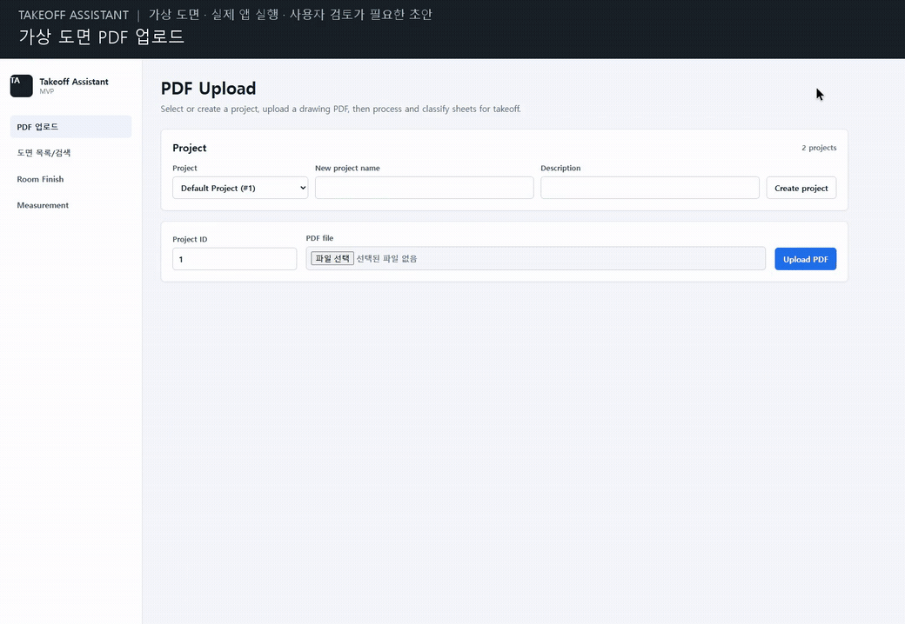
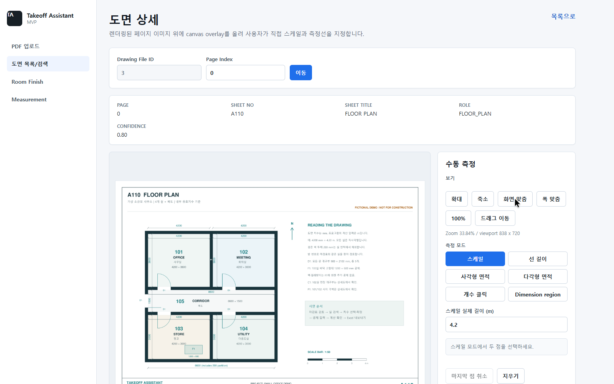
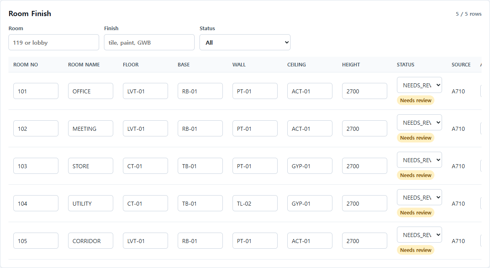
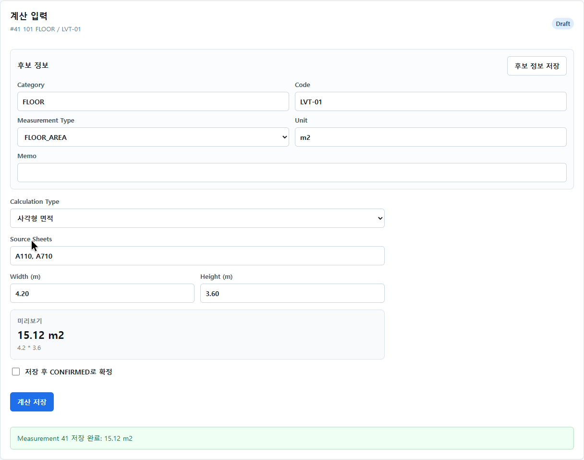

# Takeoff Assistant

PDF 건축 도면에서 마감표·치수 후보를 찾고, 사용자가 측정·계산·검수한 결과를 Excel로 내보내는 **단일 사용자용 로컬 웹 MVP**입니다.

텍스트 추출·규칙 기반 검색·수동 측정·계산·Excel 내보내기는 AI API 키 없이 사용할 수 있습니다. 선택적으로 외부 모델을 연결하면 요청 문장에서 검색 조건을 추출하거나, 사용자가 전송을 승인한 선택 영역의 치수·마감 후보를 판독할 수 있습니다. 자동 방 경계·치수선 판독과 수량 자동 확정은 제공하지 않습니다. 실무 산출 정확도와 작업 시간 절감 효과는 아직 검증하지 않았습니다.

[산출 보조 사용 안내](docs/AI_ASSIST_HANDOFF.md)와 [구현·검증 현황](docs/AI_ASSIST_AUDIT.md)에서 사용 가능한 기능과 남은 실무 검증을 확인할 수 있습니다.

## 시연

프로젝트에서 새로 만든 **가상 사무실 도면 3장**을 실제 로컬 앱에서 처리했습니다. PDF 업로드 → 마감표 검토 → 치수 직접 입력 → 계산 저장 → Excel 내보내기 흐름입니다.



[약 40초 자막 영상 다운로드 · MP4](docs/media/takeoff-demo.mp4) · [예시 도면 PDF](docs/media/takeoff-demo-drawings.pdf) · [시연 자료와 검증 내역](docs/media/README.md)

시연에서는 5개 실에서 산출 후보 20개를 만들고, 101실 바닥 한 항목에 치수를 직접 입력해 **15.12㎡**를 저장했습니다. 나머지 후보의 수량은 비어 있습니다. 가상 도면에 대한 시연이며 실제 업무 도면의 추출 정확도를 보장하지 않습니다.

## 할 수 있는 일

1. PDF 업로드, 페이지 텍스트 추출과 이미지 렌더링
2. 도면 번호·제목·역할 검색 및 마감표 후보 감지
3. 방별 마감 후보 검수·수정과 산출 후보 생성
4. 기준 길이로 축척 설정 후 선·사각형·다각형·개수 수동 측정
5. 도면 영역의 치수 텍스트 후보를 선택해 계산 입력에 반영
6. 면적·둘레·벽체·파티션·공제를 계산하고, 사용자가 확정한 상태와 출처 보존
7. `Summary`, `Details`, `Review` 시트가 있는 Excel 다운로드

추출 후보는 사용자가 확인해야 합니다. 거절한 행은 합계에서 제외하며, 확정한 행은 **재검토 시작**으로 확정을 취소한 뒤 수정합니다. 저장 계약과 회귀 사례는 [산출 무결성 문서](docs/INTEGRITY_FIXES.md)에 있습니다.

## 구성

| 영역 | 기술 |
| --- | --- |
| API·저장 | FastAPI, SQLAlchemy, SQLite, 로컬 파일 |
| PDF·Excel | PyMuPDF, openpyxl |
| 화면·테스트 | React, TypeScript, Vite, Vitest, React Testing Library |

## 빠른 시작 — Windows PowerShell

Git, Python 3.11, Node.js 24를 설치합니다. `py -3.11 --version`, `node --version`, `npm.cmd --version`이 실행되는 환경을 전제로 합니다. PowerShell 가상환경 활성화 없이 Python 실행 파일을 직접 사용합니다.

```powershell
git clone https://github.com/vanilalatte03/takeoff-assistant.git
cd takeoff-assistant
py -3.11 -m venv apps/api/.venv311
.\apps\api\.venv311\Scripts\python.exe -m pip install --require-hashes --only-binary=:all: -r apps/api/requirements-win-py311.lock
.\apps\api\.venv311\Scripts\python.exe -m pip install --no-deps --no-build-isolation -e "./apps/api[dev]"
npm.cmd --prefix apps/web ci
```

Python lock은 Windows x64 / Python 3.11용이며 API·개발·스크립트 테스트 의존성과 editable 빌드 backend를 고정합니다. PyMuPDF 1.28.2에서 손상 PDF 정리 오류를 재현해 수정했습니다. 다른 플랫폼/버전의 전체 실행은 검증하지 않았습니다. [설치 재현·보안 검사·PDF 오류 계약](docs/PDF_UPLOAD_REPRODUCIBILITY.md)을 참고하세요.

준비가 끝나면 탐색기에서 **Start Takeoff.cmd**를 더블클릭하고 **시작**을 누릅니다. 작업 화면이 브라우저에서 열립니다. 저장 후 **안전 종료**를 누르고 완료를 확인합니다. [클릭 실행·오류 해결·백업·복구 안내](docs/WINDOWS_LAUNCH.md)를 먼저 확인하세요. 다음 두 터미널 명령은 개발자용 대체 실행입니다.

첫 번째 터미널에서 API를 시작합니다.

```powershell
.\apps\api\.venv311\Scripts\python.exe -m uvicorn app.main:app --app-dir apps/api --host 127.0.0.1 --port 8000
```

두 번째 터미널도 저장소 루트에서 실행합니다.

```powershell
npm.cmd --prefix apps/web run dev -- --host 127.0.0.1 --port 5173 --strictPort
```

- 화면: <http://127.0.0.1:5173>
- API 상태: <http://127.0.0.1:8000/health>
- API 문서: <http://127.0.0.1:8000/docs>

Vite 개발 서버가 `/api` 요청을 API로 전달합니다. 로컬 검색·측정·계산에는 별도 DB 서버, Docker, AI API key가 필요하지 않습니다. 선택적 AI 검색·영역 판독 설정은 [실행 명령](docs/COMMANDS.md#선택적-ai-탐색-설정)을 따릅니다. 인증 없는 개인용 개발 서버이므로 로컬에서 사용합니다. 이 절차는 운영 배포 안내가 아닙니다.

`py`가 없다면 Python 설치/launcher를 확인하거나, Python 3.11을 가리키는 `python -m venv apps/api/.venv311`로 가상환경을 만듭니다. 나머지 명령은 동일합니다.

## 외부 도면 없이 데모 실행

[합성 도면 데모](docs/DEMO.md)는 직접 생성한 PDF로 업로드 → 마감 후보 → 계산 → Excel 흐름을 확인합니다. 고객 도면이나 비공개 업무 파일은 필요하지 않습니다.

완료 시 확인할 값은 `4.2 * 2.7 = 11.34 m2`입니다. 이는 합성 입력의 기능 동작 확인이며, 실제 도면 정확도 검증 결과가 아닙니다.

## 예시 도면으로 따라 하기

실제 업무 도면을 준비하지 않아도 [가상 도면 PDF](docs/media/takeoff-demo-drawings.pdf)로 흐름을 확인할 수 있습니다. PDF는 다운로드한 뒤 앱의 파일 선택 버튼으로 업로드합니다. 아래 도면 번호와 실 번호는 예시 파일에만 해당합니다.

### 1. PDF를 업로드하고 도면 확인

1. **PDF 업로드** 화면에서 `새 프로젝트 이름`을 입력하고 `프로젝트 만들기`로 프로젝트를 만듭니다.
2. 예시 PDF를 선택하고 `PDF 올리고 작업 시작`을 누릅니다. **작업 시작·이어서 하기** 화면으로 이어지며, 기존 PDF도 이름으로 선택해 재개할 수 있습니다.
3. `도면 준비 시작·이어서 진행`을 누릅니다. 처리·감지·분류·마감 후보·산출 후보가 순서대로 준비됩니다. [같은 화면에서 검색·계산·원본 검토·Excel까지 진행](docs/GUIDED_WORKFLOW.md)할 수 있습니다. 아래는 기존 고급 화면을 이용한 상세 확인 방법입니다.
4. 메뉴의 **도면 목록/검색**을 열고 `검색`을 누릅니다. 평면도 `A110`, 실내 마감표 `A710`, 가벽·개구부 상세 `A330`을 확인하고 평면도의 `열기`를 누릅니다.



### 2. 실별 마감 정보 검토

1. **Room Finish** 화면에서 프로젝트와 업로드한 PDF를 이름으로 선택하고 `Extract`를 누릅니다. 같은 탭에서는 앞서 선택한 PDF가 유지됩니다.
2. 101~105의 5개 실과 바닥·걸레받이·벽·천장 마감 코드를 도면과 대조합니다.
3. 잘못 읽힌 값은 표에서 수정한 뒤 해당 행의 `Save`를 누릅니다. 자동 추출된 후보는 검토가 필요한 상태로 표시됩니다.



### 3. 치수를 입력하고 수량 저장

1. **Measurement** 화면에서 같은 프로젝트와 PDF 이름을 확인한 뒤 `Generate`를 누릅니다. 5개 실 × 4개 공종으로 산출 후보 20개가 생성됩니다.
2. 101실의 `FLOOR / LVT-01` 항목을 선택합니다. 바닥 마감 물량을 계산할 항목입니다.
3. `Calculation Type`을 **사각형 면적**으로 두고 다음 값을 입력합니다.

| 화면 입력란 | 값 | 의미 |
| --- | --- | --- |
| Width (m) | `4.20` | 도면의 가로 치수 4200 mm |
| Height (m) | `3.60` | 도면의 세로 치수 3600 mm. 이 계산에서는 층고가 아님 |
| Source Sheets | `A110, A710` | 치수를 확인한 평면도와 마감표 |

4. 미리보기의 `4.2 * 3.6 = 15.12 m2`를 확인하고 `계산 저장`을 누릅니다.
5. 예시처럼 초안으로 저장하려면 확정 체크를 선택하지 않습니다. 내용을 검토하고 확정하려면 `저장 후 CONFIRMED로 확정`을 선택합니다.

**도면의 mm 치수를 계산 입력란에 넣을 때는 m로 환산해야 합니다.** 예를 들어 4200 mm는 4.20 m입니다.



이 예시는 치수 직접 입력을 사용합니다. 도면 위에서 측정하려면 도면 상세 화면에서 알려진 실제 길이로 스케일을 설정한 뒤 선·사각형·다각형 등을 측정합니다. 자동 치수 후보를 사용하는 경우에도 도면의 치수와 단위를 직접 확인해야 합니다.

### 4. Excel 내보내기

**Measurement** 화면에서 `Export Excel`을 눌러 `.xlsx` 파일을 내려받습니다. 계산 전이나 검토 중에도 내보낼 수 있으므로, 파일을 내려받았다는 사실이 모든 항목의 계산·확정을 뜻하지는 않습니다.

## Excel 결과

내보낸 파일에는 다음 세 시트가 들어 있습니다.

| 시트 | 확인할 내용 |
| --- | --- |
| Summary | 공종·마감 코드·단위별 수량 합계와 출처 도면 |
| Details | 실별 항목의 계산식, 수량, 단위, 출처, 상태, 메모 |
| Review | 제외 상태인 항목을 뺀 실별 검토 목록. 수량 누락과 확정 여부 확인 |

위 예시를 따라 하면 `Details`에서 다음 내용을 확인할 수 있습니다. 보기 쉽게 일부 열만 표시했습니다.

| 실 | 공종 / 코드 | 계산식 | 수량 | 단위 | 출처 도면 | 상태 |
| --- | --- | --- | ---: | --- | --- | --- |
| 101 OFFICE | FLOOR / LVT-01 | `4.2 * 3.6` | 15.12 | m2 | A110, A710 | DRAFT |

이 시연에서는 나머지 19개 후보의 수량이 비어 있습니다. `Summary`에는 확정 전이라도 수량이 입력된 항목이 합산되므로, 최종 사용 전에는 `Details`와 `Review`에서 상태와 계산 근거를 함께 확인해야 합니다.

## 테스트

저장소 루트에서 실행합니다.

```powershell
.\apps\api\.venv311\Scripts\python.exe -m pytest apps/api/tests
.\apps\api\.venv311\Scripts\python.exe -m pytest scripts
npm.cmd --prefix apps/web test
npm.cmd --prefix apps/web run build
```

F01~F07 수정 당시 기록은 API 158개 통과·비공개 PDF 테스트 2개 생략, 운영 스크립트 71개 통과, UI 26개 통과입니다. 비공개 샘플이 없으면 관련 테스트는 생략됩니다. UI 회귀는 테스트 DOM을 사용하며 실제 브라우저 전체 E2E와 구분합니다. 최신 검증은 각 환경에서 위 명령으로 확인할 수 있습니다.

## 지속적 통합 (CI)

GitHub Actions의 [CI workflow](.github/workflows/ci.yml)는 `main` 대상 PR과 `main` push에서 **Windows checks**를 실행합니다. Windows x64 / Python 3.11 / Node.js 24 환경에서 해시 고정 Python 의존성 설치, npm lock 설치, API·운영 스크립트·UI 테스트와 build, 공개 빈 Excel 템플릿 검증을 수행합니다.

비공개 PDF 샘플 테스트는 자료가 없어 생략될 수 있습니다. CI 통과는 실제 브라우저 전체 흐름이나 실무 산출 정확도 검증을 뜻하지 않습니다. [CI 실행·실패 확인 방법](docs/COMMANDS.md#github-actions-ci)을 참고하세요.

## 지원 제한과 남은 과제

- 로컬 추출은 텍스트가 있는 PDF와 영어 도면명·마감표 중심의 휴리스틱입니다. 스캔 PDF 전체 OCR, 한글 방 이름 검색, 모든 마감표 형식을 지원하지 않습니다. 선택적 Vision은 승인한 작은 영역의 판독 후보를 제공하며 전체 PDF OCR을 대신하지 않습니다.
- 자동 방 경계·치수선·문/창문 공제 인식은 없습니다. 숫자 후보의 단위와 방·벽의 대응은 사람이 확인해야 합니다.
- 회전 PDF의 영역/텍스트 좌표 정합과 벽 방향별 서로 다른 마감의 분리 산출은 미완료입니다.
- Excel 텍스트의 수식 해석 방지와 프런트엔드 의존성 보안 갱신을 반영했습니다. [Excel 텍스트 저장 계약](docs/F08_EXCEL_TEXT_EXPORT.md), [프런트엔드 의존성 검증](docs/F12_FRONTEND_DEPENDENCIES.md)을 참고하세요. Python 의존성은 Windows/Python 3.11 lock으로 설치합니다.
- 다중 사용자, 클라우드 배포, 견적 시스템 연동을 제공하지 않습니다.

기능 구현·자동 테스트 통과와 실무 정답 검수는 별개입니다. 최종 물량은 원본 도면 및 도메인 전문가의 검토가 필요합니다.

## 데이터와 공개 범위

실행하면 원본 PDF·렌더링 이미지는 `data/`, SQLite는 `data/takeoff_assistant.db`에 저장됩니다. 업로드 자료, DB, 산출 Excel, 환경파일은 공개하지 않습니다. 로컬 폴더 전체를 압축하면 Git에서 제외한 자료도 포함될 수 있습니다.

기존 SQLite를 사용한다면 서버를 종료하고 DB와 업로드 자료를 백업합니다. 명확한 sheet 소속이 있는 행만 PDF 소속을 채우며, 소속 불명확한 옛 수동 행은 보존하되 파일별 결과에서 제외합니다. [데이터 준비 기준](docs/SAMPLE_DATA_GUIDE.md)을 참고하세요.

## 라이선스

별도 고지가 없는 이 프로젝트의 원본 코드·문서는 **AGPL-3.0-only**로 제공합니다. [LICENSE](LICENSE)에 전문이 있으며, 적용 범위와 소스 제공 원칙은 [라이선스 정책](docs/LICENSE_POLICY.md)에 정리했습니다.

외부 라이브러리는 각자의 라이선스를 따릅니다. PyMuPDF의 AGPL/상용 이중 라이선스는 해당 공급자의 선택지이며, 이 프로젝트가 상용 라이선스를 제공하거나 구매했다는 뜻이 아닙니다. [의존성 고지](THIRD_PARTY_NOTICES.md)와 [버전별 라이선스 목록](docs/DEPENDENCY_LICENSES.md)을 확인하세요. 실제 도면·고객 자료의 이용·배포 권한은 별도입니다.

## 산출 예시 데이터셋 템플릿

[빈 Excel 템플릿](docs/templates/example_dataset_template.xlsx)은 사람이 검수한 산출 예시 20~50개를 기록하기 위한 별도 자료입니다. 앱에서 내보낸 결과나 import 형식이 아닙니다. [작성·생성·검증 방법](docs/templates/README.md)을 따르고, 실제 도면·고객 자료를 입력한 사본은 Git 밖이나 제외된 `data/samples/`에 보관합니다.

## 문서와 소스

- [실행·검사 명령](docs/COMMANDS.md)
- [사용성·평가 후속 개발 계획](phases/6-usability-evaluation/README.md)
- [MVP 범위](docs/MVP_SPEC.md), [도메인 규칙](docs/DOMAIN_RULES.md)
- [아키텍처](docs/ARCHITECTURE.md), [설계 결정](docs/ADR.md)
- [인수 기준](docs/ACCEPTANCE_CHECKLIST.md), [수동 검증](docs/QA_SMOKE_TEST.md)
- API: `apps/api/app` · 화면: `apps/web/src` · API 테스트: `apps/api/tests`

기여자용 Codex 작업 지침은 [AGENTS.md](AGENTS.md)에 있습니다. 앱 실행에는 Codex나 저장소 hook 활성화가 필요하지 않습니다.


## 선택적 산출 탐색 보조

로컬 검색과 사용자 검수 계산은 키 없이 사용할 수 있습니다. AI 검색·선택 영역 판독은 외부 환경설정으로 별도 활성화합니다. [사용 안내](docs/AI_ASSIST_HANDOFF.md), [실행 명령](docs/COMMANDS.md), [진행 현황과 미검증 범위](docs/AI_ASSIST_AUDIT.md)를 참조하세요. 실무 정답 승인과 작업시간 비교는 미완료입니다.
