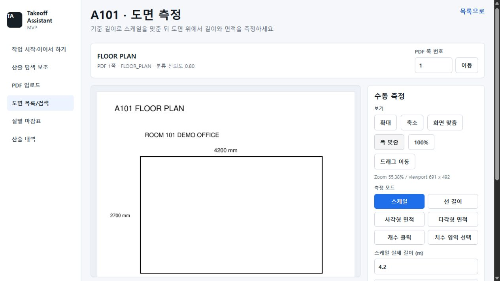

# 도면·산출 검수 화면

## 도면 검색 이어보기

**도면 목록/검색**에서 **검색**을 누르면 도면 번호(`sheetNo`)·키워드(`keyword`)·역할(`sheetRole`)을 주소에 보존한다. Room page candidates의 **Find room**을 누르면 실 번호·이름 검색어(`roomQuery`)도 보존한다. 입력만 하고 실행하지 않은 변경은 보존하지 않는다.

검색 결과의 **열기** 또는 실 도면 후보의 **Open**으로 상세 화면에 들어가도 실행한 검색 조건이 이어진다. 상세에서 **PDF 쪽 번호**로 다른 쪽을 연 뒤 **목록으로** 돌아오거나, 브라우저 뒤로·앞으로·새로고침을 사용하면 주소의 조건으로 목록을 다시 조회한다. 과거 결과의 복사본을 복원하는 것이 아니라 같은 조건으로 현재 자료를 재조회하므로 원본 자료가 바뀌면 결과도 달라질 수 있다.

도면 검색 화면에서 다른 PDF나 프로젝트를 선택하면 이전 검색 조건과 결과를 초기화한다. PDF를 선택한 최초 목록은 빈 검색 조건으로 조회한다. 조회 중·조회 실패·검색 결과 없음을 구분해 표시하며, 실패한 경우 조건을 바꾸지 않고 **검색** 또는 **Find room**을 다시 눌러 재시도할 수 있다.

## 산출 내역 검수

프로젝트와 도면 PDF를 선택하면 기존 산출 내역과 실별 현황을 자동으로 조회한다. 조회만으로 후보를 생성하거나 저장하지 않는다. PDF 미선택, 조회 중, 조회 실패, 빈 내역, 필터 결과 없음을 구분해 표시한다. 실패 원인을 확인한 뒤 **다시 불러오기**로 재시도할 수 있다.

데스크톱에서는 왼쪽 **산출 목록**의 **검토**를 누르면 오른쪽에 선택한 산출의 계산 입력과 저장 근거가 표시된다. 다른 행을 선택하면 검토 패널의 스크롤은 처음으로 돌아간다. 필터로 선택한 행이 가려져도 현재 검토 중인 산출은 번호와 함께 패널에 유지된다. 1100px 이하의 화면에서는 계산 패널이 목록 아래에 배치된다.

- 기본 필터는 **실 번호**, **검수 상태**다. **상세 필터**를 열면 분류·마감 코드·산출 종류로 좁힐 수 있다.
- **실별 검수 현황**을 열면 실별 수량 누락·확정 건수를 확인할 수 있다.
- **병합** 열에서 원본을 선택하면 병합 대상과 실행 버튼이 나타난다. 확정·거절 행은 선택할 수 없고, 병합 대상은 원본에서 제외한다.
- 목록에는 실·마감·항목·수량·단위·상태를 표시한다. 계산식과 출처는 선택한 산출의 계산·근거 패널에서 확인한다.
- 수량이 없는 후보는 **저장된 산출과 원본 대조**를 접어서 시작한다. 저장된 수량이 있으면 근거를 펼쳐 표시하며 직접 열고 닫을 수 있다.
- **산출 거절**은 선택한 행에 적용한다. 확정·거절 행의 편집 보호와 명시적인 **재검토 시작** 절차는 유지한다.
- **산출 후보 생성**, **계산 저장**, **Excel 내보내기**는 사용자가 명시적으로 실행한다. 초안은 자동 확정되지 않는다.

## 도면 측정

상단에 도면 번호·제목·역할·분류 신뢰도와 PDF 쪽 이동을 모아 도면 작업 영역을 넓혔다. **PDF 쪽 번호**에는 1부터 입력한다. URL과 API의 `page_index`는 기존처럼 0부터 시작하므로 PDF 1쪽은 `/pages/0`이다.

도면 옆의 도구로 스케일·길이·면적·개수·치수 영역 선택을 사용한다. 작은 화면에서는 도면 아래에 도구가 배치된다. 스케일·좌표, 계산식·수량·단위·출처·검수 상태의 저장 계약은 바꾸지 않는다.

위 화면은 기능 확인용으로 만든 합성 도면이며 실제 업무 자료가 아니다.

## 마감표와 탐색 보조

- **실별 마감표**도 선택한 PDF의 기존 내역을 자동 조회한다. 수동 추가 입력은 **실별 마감 추가**를 열어 사용한다.
- **산출 탐색 보조**의 **실사용 비교 기록**은 접어서 표시한다. 열면 기존 관찰 입력·시간 측정·저장·내보내기를 사용할 수 있다.
- 주요 검수·계산·측정 라벨과 상태 표시는 한글로 통일했다. API·DB·Excel의 상태 코드와 계산 타입은 그대로 유지한다.

## 검증 범위

DOM 회귀 테스트로 자동 조회, PDF 전환 중 이전 응답 무시, 조회 실패 후 재시도, 목록 선택과 패널 스크롤 초기화, 병합 원본 선택, 확정·거절 보호, 도면 쪽 이동을 확인한다. 합성 도면의 개발자 브라우저 확인은 실제 업무 도면의 산출 정확도나 실무자의 작업시간 개선을 검증한 결과가 아니다.
